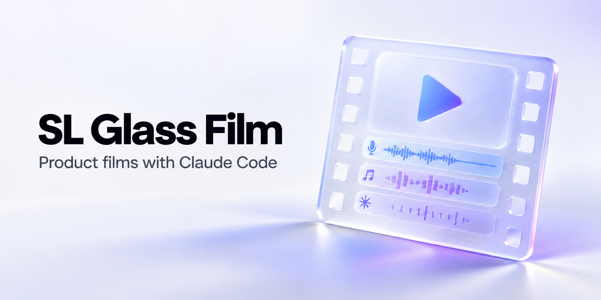
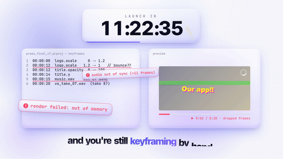

# SL Glass Film

**English** · [Русский](README.ru.md)

A Claude Code skill for product films in one recognizable motion style: a bright stage, frosted glass, kinetic type, expressive transitions and sound tied to the action. Give it your product and a brief; it builds an editable Remotion project and renders a video.



[Watch the film](#preview) · [Style](#the-style) · [Install](#installation) · [Use](#usage) · [Requirements](#requirements) · [Media rights](#media-and-license)

## Preview

[](assets/media/sl-glass-film.mp4)

**[Watch the full 20-second film](assets/media/sl-glass-film.mp4)** · [Poster](assets/media/sl-glass-film-poster.png) · [Editable promo source](motion/)

The example shows a film moving from a brief and countdown through a time-stop to a finished result. The story is an example; the skill can use a different story for your product.

## The style

[`sl-glass-film`](skills/sl-glass-film/SKILL.md) keeps the visual direction consistent while the product, scenes and duration change:

- A cool white stage with drifting blue and violet light and a fine dot grid.
- Frosted cards with translucent fill, bright edges, soft shadows and an inner glow.
- Heavy Inter Tight headlines with masked word reveals and one gradient accent per line.
- Distinct transitions between scenes, including match cuts, glass wipes, bursts, card pushes and a signature time-stop.
- Music and sound effects arranged around the story and visible actions; optional voice-over.

The skill includes [seven story patterns](skills/sl-glass-film/references/stories.md), [six scene blocks](skills/sl-glass-film/references/blocks.md), [style rules](skills/sl-glass-film/references/style.md), [transition recipes](skills/sl-glass-film/references/transitions.md), [sound guidance](skills/sl-glass-film/references/sound.md) and an editable [Remotion template](skills/sl-glass-film/template/). The agent adapts the product content and checks the finished film. Supported layouts are **16:9, 9:16 and 1:1**.

This repository contains only SL Glass Film. Other styles may be released separately in the future.

## Installation

Install the skill in Claude Code with the [skills CLI](https://github.com/vercel-labs/skills):

```sh
npx skills add SLtowl/sl-glass-film --skill sl-glass-film -g -a claude-code -y
```

From a local checkout, run:

```sh
npx skills add . --skill sl-glass-film -g -a claude-code -y
```

Omit `-g` to install only in the current project. You can also copy the complete [`skills/sl-glass-film`](skills/sl-glass-film/) directory to `.claude/skills/sl-glass-film/` manually. Start a new Claude Code session after installation.

## Usage

In Claude Code, invoke `/sl-glass-film` and provide a brief:

```text
/sl-glass-film Create a 20-second 16:9 launch film for my product.
It helps [audience] do [real outcome]. Show these three real features:
[feature 1], [feature 2], [feature 3]. Use my logo and screenshots.
End with [CTA]. Suggest two or three stories before rendering.
```

The agent proposes stories, agrees on any spoken text, builds scenes around your product and delivers an MP4, poster and editable source. Voice-over is optional. For a vertical reel or square post, specify **9:16** or **1:1** in the brief.

## Requirements

Claude Code with local file and terminal access, Node.js 18+, Chrome or Chromium, Python 3.10+, FFmpeg/ffprobe and the packages in the [template requirements](skills/sl-glass-film/template/requirements.txt). Install the template's npm dependencies before rendering. An ElevenLabs account is needed only if you choose that voice source; the skill also supports edge-tts or no voice.

## Media and license

The skill and project code are [MIT licensed](LICENSE), © 2026 SLtowl. The preview voice was generated with an ElevenLabs free-tier account and has separate, non-commercial usage terms; see [media provenance](assets/media/PROVENANCE.md). The example film's music and effects were synthesized by the included scripts. Remotion has its own [license terms](https://www.remotion.dev/docs/license).
